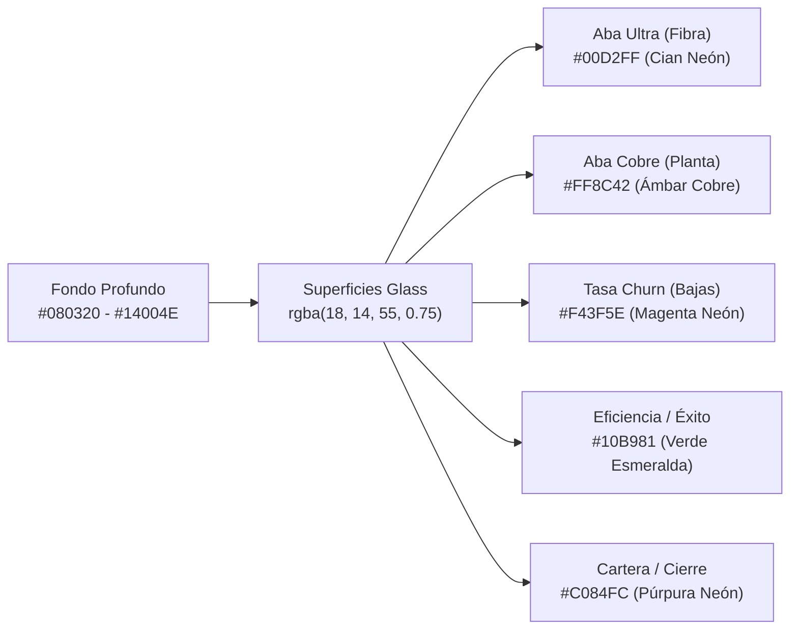
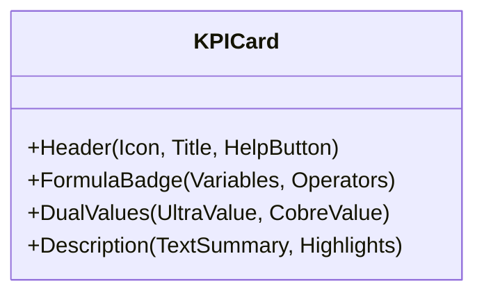

# Sistema de Diseño Visual y Manual de Estilos
## TNCC - Reporte Combinado Cobre | Fibra (iPulso)

---

## 1. Ficha Técnica y Visión General

| Parámetro | Detalle |
| :--- | :--- |
| **Producto** | Dashboard Ejecutivo TNCC (Tasa Neta de Crecimiento de Cartera) |
| **Organización / Área** | Mercadeo Hogares – Mercados Masivos (VPSS) |
| **Identidad de Marca** | **iPulso** |
| **Paradigma Estético** | *Cyber-Executive Neón Glassmorphism* (Modo Oscuro de Alto Contraste) |
| **Público Objetivo** | Comité de Dirección, Vicepresidencia, Gerencia de Producto y Planificación |
| **Versión de Diseño** | 3.5 (Sincronizado a ciclo consolidado Enero – Octubre 2026) |
| **Tecnologías Evaluadas** | **Aba Ultra** (Fibra Óptica FTTH) y **Aba Cobre** (Planta Legada xDSL) |
| **Arquitectura de Entrega** | Web autónoma, autocontenida (Single-File Offline Capable) |

---

## 2. Identidad de Marca y Logotipo (`iPulso`)

El reporte adopta la identidad visual oficial de **iPulso**, proyectando innovación, analítica en tiempo real y dinamismo tecnológico en el sector telecomunicaciones.

### 2.1. Imagotipo Oficial
- **Composición**: Tipografía corporativa sans-serif moderna con la `i` en minúscula y `Pulso` con peso semibold/bold en blanco puro (`#FFFFFF`). En la base inferior se proyecta el isotipo de la **onda de pulso electromagnético / electrocardiograma** que culmina en un **vector de flecha ascendente hacia la derecha**, simbolizando monitoreo continuo y aceleración de crecimiento.
- **Colorimetría del Logotipo**: Blanco puro monocromático sobre fondos oscuros translúcidos, sin sombras sucias ni resplandor que opaque la nitidez del trazado.
- **Ubicación en UI**: Extremo superior derecho de la cabecera ejecutiva (`.logo-box`), alineado verticalmente con el título principal.
- **Dimensiones**:
  - Desktop (>1024px): `height: 68px; width: auto;`
  - Mobile (<=768px): `height: 52px; width: auto;`
- **Incrustación Técnica**: Pre-codificado en **Data URL Base64** dentro del HTML (`#headerLogoImg`), garantizando renderizado perfecto sin dependencias de red o archivos locales externos.

---

## 3. Paleta Cromática y Tokens de Diseño (Color System)

El lenguaje cromático utiliza una base oscura profunda combinada con **acentos de neón cibernético** con saturaciones calibradas para evitar la fatiga visual y destacar con máxima jerarquía los umbrales de decisión.



### 3.1. Fondos y Superficies (Surfaces & Glassmorphism)

| Variable CSS | Valor Hex / RGBA | Aplicación y Propósito |
| :--- | :--- | :--- |
| `--bg-gradient-start` | `#E10098` | Vértice de iluminación superior magenta en fondo radial |
| `--bg-gradient-mid1` | `#A00078` | Transición cromática intermedia del lienzo general |
| `--bg-gradient-mid2` | `#160058` | Matiz azul-índigo nocturno para profundidad |
| `--bg-gradient-end` | `#080320` | Base abisal oscura del cuerpo (`<body>`) |
| `--card-bg-dark` | `rgba(15, 12, 45, 0.85)` | Relleno base de tarjetas y contenedores |
| `--card-bg-glass` | `rgba(18, 14, 55, 0.70)` | Acabado translúcido con `backdrop-filter: blur(14px)` |
| `--card-border-glow` | `rgba(225, 0, 152, 0.35)` | Borde de énfasis magenta activo |
| `--card-cyan-border` | `rgba(0, 210, 255, 0.38)` | Borde perimetral para elementos de Aba Ultra |
| `--card-cobre-border` | `rgba(255, 140, 66, 0.38)` | Borde perimetral para elementos de Aba Cobre |

### 3.2. Colores Semánticos por Tecnología y Flujo

| Elemento / Dimensión | Color Hex | RGBA de Contenedor | Efecto Resplandor (Glow) |
| :--- | :--- | :--- | :--- |
| **Aba Ultra (Fibra)** | `#00D2FF` / `#38bdf8` | `rgba(0, 210, 255, 0.15)` | `0 0 25px rgba(0, 210, 255, 0.45)` |
| **Aba Cobre (Legado)** | `#FF8C42` / `#fb923c` | `rgba(255, 140, 66, 0.15)` | `0 0 25px rgba(255, 140, 66, 0.45)` |
| **Tasa Churn (Fibra)** | `#F43F5E` / `#fb7185` | `rgba(244, 63, 94, 0.15)` | `0 0 20px rgba(244, 63, 94, 0.40)` |
| **Instalaciones / Eficiencia** | `#10B981` / `#34d399` | `rgba(16, 185, 129, 0.15)` | `0 0 20px rgba(16, 185, 129, 0.35)` |
| **Cartera de Cierre** | `#C084FC` / `#a855f7` | `rgba(192, 132, 252, 0.15)` | `0 0 20px rgba(192, 132, 252, 0.35)` |
| **Metas / Umbrales / Años** | `#FBBF24` / `#FFD700` | `rgba(245, 158, 11, 0.15)` | `0 0 20px rgba(245, 158, 11, 0.35)` |

### 3.3. Textos y Contraste de Lectura

| Variable CSS | Hex | Uso en Interfaz |
| :--- | :--- | :--- |
| `--text-white` | `#FFFFFF` | Títulos principales, valores numéricos maestros |
| `--text-pink-bright` | `#FF2AAB` | Acento en palabra clave "Fibra", botones de acción |
| `--text-muted` | `#B8C4E6` | Párrafos narrativos y descripciones de tarjetas |
| `--text-dim` | `#8899B8` | Etiquetas secundarias, fórmulas, leyendas de ejes |

---

## 4. Tipografía y Jerarquía Visual (Typography System)

Se seleccionó una combinación armónica de fuentes de alta legibilidad para interfaces analíticas:

1. **Fuente Primaria (`--font-primary`)**: `'Outfit', -apple-system, BlinkMacSystemFont, sans-serif`
   - *Rasgos*: Geométrica, moderna, neutral y con alta distinción entre caracteres en modo oscuro.
   - *Aplicación*: Títulos, subtítulos, botones, badges y párrafos descriptivos.
2. **Fuente Monoespaciada (`--font-mono`)**: `'JetBrains Mono', monospace`
   - *Rasgos*: Ancho constante para cifras tabulares, legibilidad de porcentajes y fórmulas matemáticas.
   - *Aplicación*: Valores numéricos destacados, fórmulas (`kpi-formula-badge`), datos en tablas y tooltips.
3. **Fuente Secundaria (`--font-secondary`)**: `'Plus Jakarta Sans', sans-serif`
   - *Aplicación*: Textos legales, tooltips y modales de soporte metodológico.

### 4.1. Escala Tipográfica Modular

| Nivel Jerárquico | Tamaño (rem / px) | Peso (Weight) | Familia | Caso de Uso |
| :--- | :--- | :--- | :--- | :--- |
| **H1 (Título Principal)** | `1.75rem` / `28px` | `800` (ExtraBold) | Outfit | Encabezado del reporte |
| **H2 (Títulos KPI)** | `1.05rem` / `16.8px` | `700` (Bold) | Outfit | Cabecera de tarjetas métricas |
| **Big Stat Number** | `2.20rem` / `35.2px` | `800` (ExtraBold) | JetBrains Mono | Porcentajes y Ratios principales |
| **Sub Stat Metric** | `0.78rem` / `12.5px` | `600` (SemiBold) | JetBrains Mono | Desglose inferior (inst/ret, promedios) |
| **Badge / Formula** | `0.70rem` / `11.2px` | `500` / `600` | JetBrains Mono | Pastillas de fórmulas e insignias |
| **Cuerpo Narrativo** | `0.84rem` / `13.4px` | `400` / `500` | Outfit | Resumen ejecutivo y diagnósticos |

---

## 5. Arquitectura de Componentes y Wireframe

```
+---------------------------------------------------------------------------------------------------+
|  [⚡ TNCC Analytics Studio (Barra Superior de Edición - Colapsable)]                             |
+---------------------------------------------------------------------------------------------------+
|  TNCC - Reporte Combinado Cobre | Fibra                                         [ LOGO iPulso ]   |
|  [⚡ ABA ULTRA]  [⛃ ABA COBRE]  [⚯ ANÁLISIS CRUZADO]                                              |
|                                                                                                   |
|  MODO DE VISUALIZACIÓN: [ ⛃ Vista Combinada ]  [ ⚡ Aba Ultra ]  [ ⛃ Aba Cobre ]                  |
|  Un vistazo profundo al crecimiento, la retención, la migración... período enero a octubre 2026.  |
|  Año Fiscal: [ 2026 ]  |  📅 Ciclo Consolidado (Ene - Oct)                                        |
+---------------------------------------------------------------------------------------------------+
|                                     GRID DE 5 TARJETAS KPI                                       |
|  +---------------+ +---------------+ +---------------+ +---------------+ +--------------------+ |
|  | 1. TNCC       | | 2. EFICIENCIA | | 3. CARTERA    | | 4. BALANCE    | | 5. CHURN FIBRA     | |
|  | Acumulado     | | Comercial     | | Suscriptores  | | Flujos Netos  | | Acumulado Año    | |
|  | Ultra: +0.96% | | Ultra:  1.04  | | Ultra: 171.866| | Ultra: +1.679 | | Acumu: 22,38%    | |
|  | Cobre:-27.40% | | Cobre:  0.02  | | Cobre: 1.160M | | Cobre:-415.8k | | Prom:   2,11%    | |
|  +---------------+ +---------------+ +---------------+ +---------------+ +--------------------+ |
+---------------------------------------------------------------------------------------------------+
|                                GRÁFICO DE EVOLUCIÓN MENSUAL                                       |
|  Badges: [Pron. Ultra: +0.17%] [Pron. Cobre: -3.14%] [Churn: 22.38%] [Ene - Oct 2026]            |
|  Series Visibles: [TNCC F%] [Churn F%] [TNCC C%] [Inst F] [Inst C] [Ret F] [Ret C] [Net F] [Cart]|
|  +---------------------------------------------------------------------------------------------+  |
|  |   [Canvas Chart.js: Barras Verdes/Rojas + Curvas TNCC + Línea Cartera Púrpura Discontinua]   |  |
|  +---------------------------------------------------------------------------------------------+  |
+---------------------------------------------------------------------------------------------------+
|  MATRIZ DE CRITERIOS NORMATIVOS TNCC (Aba Ultra & Aba Cobre)                                      |
+---------------------------------------------------------------------------------------------------+
|  HALLAZGOS CRUZADOS E INTERACCIÓN TECNOLÓGICA (4 Cuadrantes Estratégicos)                         |
+---------------------------------------------------------------------------------------------------+
|  DIAGNÓSTICO Y ANÁLISIS EJECUTIVO EN TIEMPO REAL (Resúmenes Binarizados)                          |
+---------------------------------------------------------------------------------------------------+
```

---

## 6. Especificación Detallada de Módulos Visuales

### 6.1. Encabezado Corporativo (Header Section)
- **Título**: Texto con gradiente blanco a magenta:
  ```css
  background: linear-gradient(90deg, #FFFFFF 70%, #FF2AAB 100%);
  -webkit-background-clip: text;
  -webkit-text-fill-color: transparent;
  ```
- **Pastillas de Navegación Rápida (`.quick-nav-pill`)**:
  - `ABA ULTRA`: Fondo `rgba(0, 210, 255, 0.12)`, borde `#00D2FF`, texto cian.
  - `ABA COBRE`: Fondo `rgba(255, 140, 66, 0.12)`, borde `#FF8C42`, texto naranja.
  - `ANÁLISIS CRUZADO`: Fondo `rgba(225, 0, 152, 0.12)`, borde `#E10098`, texto magenta.
  - Interacción: Anclaje suave (`scroll-behavior: smooth`) a cada sección del reporte.

### 6.2. Cuadrícula de Tarjetas KPI Ejecutivas (5 Cards Grid)
Diseñadas con estructura simétrica de **doble columna** para confrontar la tecnología en despliegue (Ultra) vs. la planta en apagado (Cobre):



1. **Tarjeta 1 – Tasa Neta de Crecimiento (TNCC Acumulado)**
   - *Icono*: `trending-up` en caja circular cian.
   - *Fórmula*: `TNCC = (Instalaciones - Retiros) / Cartera Inicio`.
   - *Valores*: Aba Ultra `+0,96%` (Prom: +0,17%/m) \| Aba Cobre `-27,40%` (Prom: -3,14%/m).
   - *Semáforo*: Clasificación dinámica en verde/cian (*Saludable*).
2. **Tarjeta 2 – Eficiencia Comercial (Instalación vs. Retiro)**
   - *Icono*: `scale` (balanza) en caja verde esmeralda.
   - *Fórmula*: `Ratio = Instalaciones / Retiros`.
   - *Valores*: Aba Ultra **`1.04`** (`40.498 / 38.819`) \| Aba Cobre **`0.02`** (`8.884 / 424.778`).
   - *Diagnóstico*: Identifica formalmente la superación del umbral de reemplazo comercial (104 instalaciones por cada 100 retiros).
3. **Tarjeta 3 – Cartera de Suscriptores (Enero vs. Octubre)**
   - *Icono*: `users` en caja azul índigo.
   - *Fórmula*: `Variación = Base Octubre - Base Enero`.
   - *Valores*: Aba Ultra **`171.866`** (`Inicio: 175.609`) \| Aba Cobre **`1.160.781`** (`Inicio: 1.517.643`).
   - *Diagnóstico*: Cobre contrae 356k cuentas; la fibra amortigua el impacto en 171.866 suscriptores activos.
4. **Tarjeta 4 – Balance de Flujos Netos (Consolidado Ene - Oct)**
   - *Icono*: `arrow-left-right` en caja púrpura neón.
   - *Fórmula*: `Neto = Total Instalaciones - Total Retiros`.
   - *Valores*: Aba Ultra **`+1.679`** (`+40.498 inst / -38.819 ret`) \| Aba Cobre **`-415.894`** (`+8.884 inst / -424.778 ret`).
   - *Diagnóstico*: Confirmación de saldo neto positivo para fibra en el acumulado anual.
5. **Tarjeta 5 – Tasa Churn Acumulado Año (Fibra Ene - Oct)**
   - *Icono*: `user-x` en caja magenta neón.
   - *Fórmula*: `Churn = Retiros Acumulados / Promedio Cartera`.
   - *Valores*: CHURN ACUMULADO **`22,38%`** (Retiros: 38.819 / Prom: 173.445) \| PROM. MENSUAL **`2,11%`** (Sin Julio: `1,05%`).
   - *Diagnóstico*: Evidencia el impacto atípico del evento de julio (`11,70%`) y la normalización en los meses subsiguientes.

### 6.3. Gráfico de Evolución Mensual Multi-Eje (Chart.js)
El gráfico es el núcleo visual del análisis temporal y combina 4 tipos de escalas sincronizadas:
- **Eje Y Principal Izquierdo (`yTncc`)**: Porcentajes de TNCC mensual con rango dinámico adaptable (-12% a +5%).
- **Eje Y Secundario Izquierdo (`yCarteraFibra`)**: Escala de cartera en miles (`170k` a `195k`) con línea morada punteada (`borderDash: [5, 4]`) y nodos circulares destacados.
- **Eje Y Secundario Izquierdo (`yCarteraCobre`)**: Escala en millones (`1.10M` a `1.55M`) con línea ámbar discontinua.
- **Eje Y Derecho (`yFlujos`)**: Escala absoluta de volumen físico de líneas (0 a 25.000) para barras de instalaciones (verde menta `#10B981`) y retiros (rojo coral `#F43F5E`).
- **Líneas de Umbral Normativo (Benchmarks)**:
  - Umbral inferior `0.5%`: Línea horizontal cian discontinua.
  - Umbral superior `2.0%`: Línea horizontal verde esmeralda discontinua.

### 6.4. Matriz de Criterios (Leyenda Normativa)
Tablas binarizadas con indicación visual de cuadrante en tiempo real:
- **Rango 0% a 0.5% (o menor)**: *Muy lento o estancado* (Rojo/Rosa `#fb7185`).
- **Rango 0.6% a 2%**: *Saludable* (Cian/Azul `#38bdf8`). Fila activa para Aba Ultra (`active-row-moderada`) con resplandor cyan y badge `Ultra: +0.96%`.
- **Rango > 2%**: *Excelente* (Verde `#34d399`).

### 6.5. Hallazgos Cruzados e Interacción Tecnológica (Cobre vs. Fibra)
Cuadrícula 2x2 de tarjetas con bordes en degradado temático:
1. **Retiro de Planta Cobre** (Ámbar): Justificación del apagado deliberado de centrales obsoletas.
2. **Diagnóstico Matriz: Fibra** (Cian): Calificación formal de la tasa en estado saludable.
3. **Fuga Fuera de la Empresa** (Naranja): Cuantificación del desenganche (>90% de los retiros de cobre no migraron a la fibra interna).
4. **Blindaje de Cartera FTTH** (Verde Menta): Meta de retención para evitar churn interno y sostener la ratio 1.04.

---

## 7. Responsividad y Adaptabilidad (Responsive Design System)

| Dispositivo / Pantalla | Ancho (Viewport) | Comportamiento del Layout |
| :--- | :--- | :--- |
| **Monitores Ultra-Wide / Desktop** | `> 1280px` | Contenedor centrado max `1480px`, grid de 5 tarjetas KPI en fila horizontal completa. |
| **Laptops y Tablets Horizontales** | `992px - 1279px` | Grid de KPIs en formato flexible `3 + 2`, gráfico optimizado con reducción de márgenes. |
| **Tablets Verticales** | `768px - 991px` | Tarjetas KPI en 2 columnas, logo ajustado a `52px`, selector de series con scroll horizontal suave. |
| **Smartphones y Móviles** | `< 767px` | 1 columna vertical para KPIs y narrativas, tablas con scroll horizontal nativo, padding lateral de `12px`. |
| **Pantallas Ultra-Compactas** | `<= 360px` | Píldoras en tamaño micro (`font-size: 0.65rem`), valores numéricos reducidos para evitar solapamientos. |

---

## 8. Microinteracciones y Efectos Visuales

- **Backdrop Blur**: Utilizado en cabeceras fijas y modales: `backdrop-filter: blur(14px); -webkit-backdrop-filter: blur(14px);`.
- **Transiciones Suaves**: Todos los elementos interactivos cuentan con `transition: all 0.25s cubic-bezier(0.4, 0, 0.2, 1);`.
- **Efecto Hover en Tarjetas**: Ligera elevación espacial con desplazamiento vertical (`transform: translateY(-3px)`) e intensificación del resplandor de borde.
- **Scrollbars Estilizados**: Trazado ultra-fino de 7px con gradiente rosa-cian sobre riel oscuro transparente.
- **Modales de Ayuda Metodológica (`indicatorHelpModal`)**: Ventanas emergentes de apoyo técnico al hacer clic en el botón `(i)` de cada KPI, detallando fórmula, interpretación de negocio y umbrales normativos.

---

## 9. Directrices de Mantenimiento de la Identidad Visual

1. **Preservar el Modo Oscuro Neón**: Nunca sustituir los fondos oscuros por fondos blancos planos para garantizar la visibilidad de los resplandores cromáticos de los datos de fibra y cobre.
2. **Consistencia de Cifras**: Utilizar siempre la tipografía `JetBrains Mono` con formateo numérico de punto para miles y coma para decimales.
3. **Actualización del Logotipo**: En caso de modificar el imagotipo `iPulso`, actualizar simultáneamente `img/logo-ipulso.png`, `img/logo-base64.txt` y `js/embedded-assets.js`.
4. **Integridad Offline**: Toda modificación debe mantener la capacidad del reporte de exportarse como archivo `.html` autocontenido sin romper estilos ni imágenes.

---
*Manual generado para el proyecto Dashboard-TNCC-ampliado.*
*Identidad gráfica © iPulso | Mercadeo Hogares – Mercados Masivos.*
